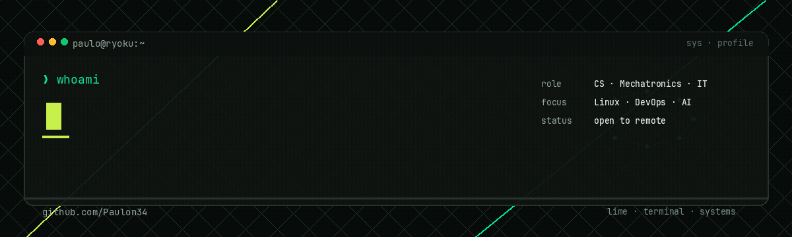
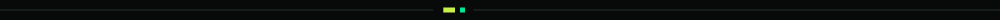

<!--
  GitHub profile README — Paulo Henrique (Paulon34)
  Default language: pt-BR (./README.md)  |  This file: English
  Animated banner: ./assets/banner.gif  |  fallback: ./assets/banner-static.png
-->

<a href="./README.md">PT-BR</a> · **English**

 

 

  Prefer no animation?
  <a href="./assets/banner-static.png">static PNG</a>
  ·
  <a href="./assets/banner-static.svg">SVG</a>

---

### `whoami`

**Computer Science** student, **Mechatronics** technician, and **IT infrastructure & support** professional.

I build, connect, and automate technology — focused on **Linux**, servers, networks, software, **AI**, automation, DevOps, virtualization, and open source.

Currently an IT intern at **Indufix** (support, infra, Linux, Windows, networking, APIs, Docker, n8n). Previously technical support at Teleperformance, plus hands-on e-commerce admin / business OS experience.

Open to **remote** roles.

---

### favorite tech

  
  
  
  
  
   
  
  
  
  
  

`Linux` · `Docker` · `NixOS` · `Proxmox` · `Tailscale` · `Nextcloud` · `n8n` · `APIs` · `JavaScript` · `Windows` · `Networking` · `AD` · `Zabbix` · `Git` · `VS Code`

---

### featured projects

> Private repos stay private. Public links only when a project is published.

| Project | About | Status |
| --- | --- | --- |
| **Ryoku NixOS** | Personal NixOS system/setup — reproducible, declarative, aimed at workstation use and Linux experimentation. | Active · private |
| **JARVIS** | Voice / advanced AI assistant — planning and incremental build. | Planning / in development |
| **Portfolio** | Professional site with terminal identity (lime/emerald/dark), PT/EN, and real projects. | In progress |
| **HomeLab & Automation** | Home lab with Proxmox, Docker, self-hosted services (e.g. Nextcloud), Tailscale, n8n, APIs, and monitoring (e.g. Zabbix). No public topology/IPs. | Ongoing · private |

<!-- Replace the portfolio URL after publish (Cloudflare Pages / pages.dev): -->
<!-- Portfolio: https://YOUR-PORTFOLIO.pages.dev -->

---

### Linux journey

Curiosity about systems and infrastructure turned into daily practice: Linux on the desktop, servers, networking, virtualization, and automation.

Linux is the base of my study and work (including desktops such as **CachyOS** / KDE), and it carries into the HomeLab and IT day-to-day — support, hybrid Linux/Windows infra, containers, and n8n workflows.

The goal: real, documented, useful systems — not throwaway demos.

---

### contact

- GitHub: [github.com/Paulon34](https://github.com/Paulon34)
- LinkedIn: [paulo-henrique-dev-fullstack](https://www.linkedin.com/in/paulo-henrique-dev-fullstack/)
- Email: [ph3073610@gmail.com](mailto:ph3073610@gmail.com)
- Portfolio: _coming soon — link will be added after deploy_

Open to **remote** roles.

---

<code>paulo@ryoku:~</code> · building, connecting, and automating

