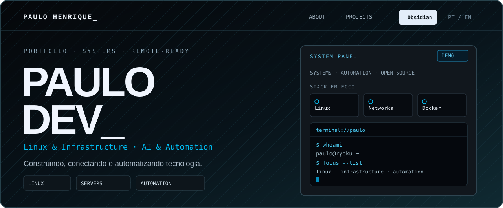

<!-- GitHub profile • English | Português: ./README.md | Static Obsidian hero: ./assets/portfolio-obsidian.svg -->

[🇧🇷 Português](./README.md) · **🇬🇧 English**

 

**Linux & Infrastructure · Software · AI & Automation · Open Source**

Obsidian on GitHub · Explore Electric Blue and Light Pro themes on the <a href="https://portfolio-dhm.pages.dev">live site</a>.

---

### <code>$ whoami</code>

I'm **Paulo Henrique**, a **Computer Science** student and **Mechatronics** technician with hands-on experience in **IT infrastructure and support**.

I build, connect and automate technology. As an IT intern at **Indufix**, I work with **Linux, Windows, networks, APIs, Docker and n8n automations**. Previously, I worked in **inbound customer service at Teleperformance**, developing communication and active listening skills while handling non-technical requests.

I'm interested in **remote** opportunities across infrastructure, software development and automation.

~~~text
paulo@ryoku:~$ focus --list
linux · infrastructure · networks · software · AI · automation · open source

paulo@ryoku:~$ projects --open-source
ryoku-desktop · portfolio-starter

paulo@ryoku:~$ projects --in-progress
jarvis (private) · homelab
~~~

### <code>// stack in focus</code>

### <code>// open-source projects</code>

<table>
<tr>
<td width="50%" valign="top">

#### [Ryoku Desktop](https://github.com/Paulon34/ryoku-desktop)

A **reproducible NixOS desktop** with Hyprland, the **Quattro and Islands** shell styles, **Material You** colors and the **Ryoku Settings** app (Qt 6/C++). Ships a review-first hardware bootstrap and **Minimal/Full** profiles.

`NixOS` `Hyprland` `Quickshell` `Qt 6` `C++` · MIT licensed

**[Public source →](https://github.com/Paulon34/ryoku-desktop)**

</td>
<td width="50%" valign="top">

#### [Portfolio Starter](https://github.com/Paulon34/portfolio-starter)

My first **open-source** template: a React and TypeScript portfolio with three themes, PT/EN, responsive design and résumé PDFs — with fictional data, ready to adapt.

`React` `TypeScript` `Vite`

**[Public source →](https://github.com/Paulon34/portfolio-starter)**

</td>
</tr>
</table>

### <code>// other projects</code>

| Project | What it does | Access |
| :--- | :--- | :--- |
| **[Portfolio 3.0](https://portfolio-dhm.pages.dev)** | My live website on Cloudflare Pages, with privately managed content and automated GitHub deployments. | **[Live site](https://portfolio-dhm.pages.dev)** |
| **JARVIS** | Voice and AI assistant undergoing incremental development. | Private · in development |
| **HomeLab & Automation** | Area of hands-on experience: self-hosted services, virtualization, containers, private networking and automations. | Private infrastructure |

> Private repositories and infrastructure details stay private. Public projects have direct links above.

### <code>// how my portfolio ships</code>

Portfolio publishing flow

~~~text
Private Portfolio Admin
        │  edit → validate → approve
        ▼
GitHub (private repository)
        │  commit to main
        ▼
Cloudflare Pages
        │  successful build
        ▼
portfolio-dhm.pages.dev  ✓
~~~

The **reusable, fictional-data frontend** is available as [Portfolio Starter](https://github.com/Paulon34/portfolio-starter). My private admin backend and HomeLab infrastructure are not published.

### <code>// my journey</code>

I learn by building: studying Computer Science, applying my Mechatronics background, and working on Linux, infrastructure and automation projects. I enjoy documenting what I build and turning ideas into useful systems — Ryoku Desktop grew out of my own daily NixOS setup.

### <code>// contact</code>

**[🌐 Portfolio](https://portfolio-dhm.pages.dev)** · **[💻 GitHub](https://github.com/Paulon34)** · **[🤝 LinkedIn](https://www.linkedin.com/in/paulo-henrique-dev-fullstack/)** · **[✉️ Email](mailto:ph3073610@gmail.com)**

 

<code>paulo@ryoku:~$</code> building, connecting and automating technology.

