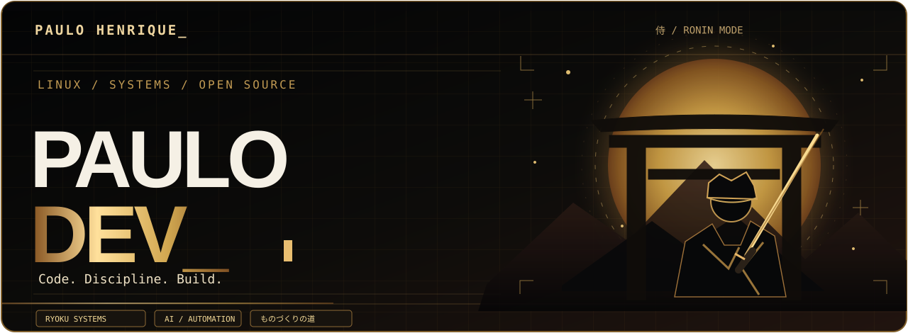

<!-- PAULO.DEV / RONIN GOLD — GitHub profile English. Português: README.md -->
<div align="center">

[🇧🇷 Português](./README.md) · **🇬🇧 English**

<a href="https://portfolio-dhm.pages.dev">
  
</a>

<a href="https://github.com/Paulon34">
  
</a>

**「ものづくりの道」 · Build, learn and evolve.**

[](https://portfolio-dhm.pages.dev)
[](https://github.com/Paulon34/ryoku-os)
[](https://github.com/Paulon34/ryoku-desktop)
[](https://www.linkedin.com/in/paulo-henrique-dev-fullstack/)

<sub>A new aesthetic for the same identity: Linux, infrastructure, software, AI and open source. My portfolio still offers its other themes.</sub>


</div>

### `01 // whoami — behind the terminal`

I'm **Paulo Henrique**, a **Computer Science** student and **Mechatronics** technician with hands-on experience in **IT infrastructure and support**.

I build, connect and automate technology. As an IT intern at **Indufix**, I work with **Linux, Windows, networks, APIs, Docker and n8n automations**. Previously, I worked in **inbound customer service at Teleperformance**, developing communication and active listening skills while handling non-technical requests.

I'm interested in **remote** opportunities in infrastructure, software development and automation.

```console
paulo@ryoku:~$ ./ronin --status
[ONLINE] Linux & Infrastructure  /  Software  /  AI & Automation
[BUILD]  Ryoku Desktop + Ryoku OS (modular Debian)
[LAB]    JARVIS (private) + HomeLab
[MODE]   learn → build → document → repeat
```

### `02 // arsenal — tech stack`

<div align="center">


<br/>


</div>

### `03 // quests — featured projects`

<table>
<tr>
<td width="50%" valign="top">

**🐧 [Ryoku Desktop](https://github.com/Paulon34/ryoku-desktop)**

A **reproducible NixOS desktop** with Hyprland, DMS/Quickshell, **Quattro & Islands** styles, **Material You** colors and the **Ryoku Settings** app (Qt 6/C++).

`NixOS` `Hyprland` `QML` `Qt 6` `C++` · MIT

</td>
<td width="50%" valign="top">

**⚔️ [Ryoku OS](https://github.com/Paulon34/ryoku-os)**

An ongoing project to bring the Ryoku experience to **Debian 13**, with Niri, modular desktop components and a plan for reproducible user profiles.

`Debian` `Niri` `Home Manager` `DMS` · in development

</td>
</tr>
<tr>
<td width="50%" valign="top">

**🧩 [Portfolio Starter](https://github.com/Paulon34/portfolio-starter)**

An **open-source** React, TypeScript and Vite template with three themes, PT/EN, responsive layouts and example data for customization.

`React` `TypeScript` `Vite`

</td>
<td width="50%" valign="top">

**🌐 [Portfolio 3.0](https://portfolio-dhm.pages.dev)**

A live portfolio on Cloudflare Pages with privately managed content and automated deployment. Reusable frontend code is available in **Portfolio Starter**.

`Cloudflare Pages` `CI/CD` `Portfolio`

</td>
</tr>
</table>

<details>
<summary><b>🎮 Side quests — lab & automation</b></summary>

| Project | What I'm working on | Visibility |
| :-- | :-- | :-- |
| **JARVIS** | Voice and AI assistant under incremental development | Private |
| **HomeLab** | Virtualization, self-hosted services, private networking and containers | Private infrastructure |
| **Automation** | Linux, APIs and n8n integrations | Studies and projects |

Administrative backends and infrastructure details stay private. Only public projects are linked above.

</details>

### `04 // player stats — contributions`

<div align="center">
  
</div>

<sub>These cards use a third-party service and may occasionally load slowly or be unavailable.</sub>

### `05 // journey — the craft of building`

I learn by building: studying Computer Science, applying my Mechatronics background and working on Linux, infrastructure and automation projects. I enjoy documenting what I build and turning ideas into useful systems — Ryoku Desktop grew out of my daily NixOS setup.

<details>
<summary><b>🛠️ How my portfolio ships</b></summary>

```text
Private Portfolio Admin
        │ edit → validate → approve
        ▼
GitHub (private repository)
        │ approved commit
        ▼
Cloudflare Pages
        │ build
        ▼
portfolio-dhm.pages.dev
```

The reusable, fictional-data frontend is available in [Portfolio Starter](https://github.com/Paulon34/portfolio-starter).

</details>

### `06 // guild — contact`

**[🌐 Portfolio](https://portfolio-dhm.pages.dev)** · **[💻 GitHub](https://github.com/Paulon34)** · **[🤝 LinkedIn](https://www.linkedin.com/in/paulo-henrique-dev-fullstack/)** · **[✉️ Email](mailto:ph3073610@gmail.com)**

<div align="center">
  
  <sub><code>paulo@ryoku:~$</code> Building, connecting and automating technology. · 侍</sub>
</div>
