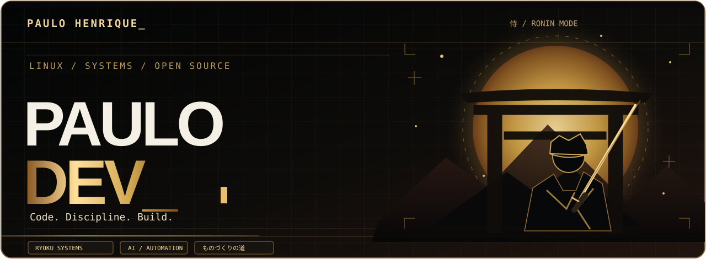
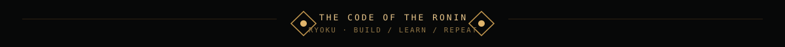

<!-- PAULO.DEV / RONIN GOLD — GitHub profile PT-BR. English: README.en.md -->
<div align="center">

**🇧🇷 Português** · [🇬🇧 English](./README.en.md)

<a href="https://portfolio-dhm.pages.dev">
  
</a>

<a href="https://github.com/Paulon34">
  
</a>

**「ものづくりの道」 · Criar, aprender e evoluir.**

[](https://portfolio-dhm.pages.dev)
[](https://github.com/Paulon34/ryoku-os)
[](https://github.com/Paulon34/ryoku-desktop)
[](https://www.linkedin.com/in/paulo-henrique-dev-fullstack/)

<sub>Uma estética nova para a mesma identidade: Linux, infraestrutura, software, IA e projetos open source. O portfólio mantém seus outros temas.</sub>


</div>

### `01 // whoami — o ronin por trás do terminal`

Sou **Paulo Henrique**, estudante de **Ciência da Computação** e técnico em **Mecatrônica**, com atuação em **infraestrutura e suporte de TI**.

Construo, conecto e automatizo tecnologia. No estágio de TI na **Indufix**, trabalho com **Linux, Windows, redes, APIs, Docker e automações com n8n**. Antes, trabalhei com **atendimento receptivo na Teleperformance**, desenvolvendo comunicação, escuta ativa e atendimento não técnico.

Busco oportunidades **remotas** para continuar evoluindo em infraestrutura, desenvolvimento de software e automação.

```console
paulo@ryoku:~$ ./ronin --status
[ONLINE] Linux & Infrastructure  /  Software  /  AI & Automation
[BUILD]  Ryoku Desktop + Ryoku OS (Debian modular)
[LAB]    JARVIS (privado) + HomeLab
[MODE]   aprender → construir → documentar → repetir
```

### `02 // arsenal — minha stack`

<div align="center">


<br/>


</div>

### `03 // quests — projetos em destaque`

<table>
<tr>
<td width="50%" valign="top">

**🐧 [Ryoku Desktop](https://github.com/Paulon34/ryoku-desktop)**

Desktop **NixOS reproduzível**, com Hyprland, DMS/Quickshell, estilos **Quattro & Islands**, cores **Material You** e o aplicativo **Ryoku Settings** (Qt 6/C++).

`NixOS` `Hyprland` `QML` `Qt 6` `C++` · MIT

</td>
<td width="50%" valign="top">

**⚔️ [Ryoku OS](https://github.com/Paulon34/ryoku-os)**

Projeto em desenvolvimento: levar a experiência Ryoku para o **Debian 13**, com Niri, desktop modular e a proposta de perfis reproduzíveis.

`Debian` `Niri` `Home Manager` `DMS` · em desenvolvimento

</td>
</tr>
<tr>
<td width="50%" valign="top">

**🧩 [Portfolio Starter](https://github.com/Paulon34/portfolio-starter)**

Template **open source** com React, TypeScript, Vite, três temas, PT/EN e layout responsivo. Dados de exemplo para quem quiser adaptar.

`React` `TypeScript` `Vite`

</td>
<td width="50%" valign="top">

**🌐 [Portfólio 3.0](https://portfolio-dhm.pages.dev)**

Portfólio publicado na Cloudflare Pages, com conteúdo administrado privadamente e deploy automatizado. Código reutilizável disponível no **Portfolio Starter**.

`Cloudflare Pages` `CI/CD` `Portfolio`

</td>
</tr>
</table>

<details>
<summary><b>🎮 Missões secundárias — laboratório & automação</b></summary>

| Projeto | O que estou construindo | Visibilidade |
| :-- | :-- | :-- |
| **JARVIS** | Assistente de voz e IA em desenvolvimento incremental | Privado |
| **HomeLab** | Virtualização, serviços self-hosted, redes privadas e containers | Infraestrutura privada |
| **Automação** | Integrações e rotinas com n8n, APIs e Linux | Estudos e projetos |

O código do meu painel administrativo e os detalhes da infraestrutura permanecem privados. Os links públicos acima levam apenas aos projetos publicados.

</details>

### `04 // player stats — contribuições`

<div align="center">
  
</div>

<sub>Os números são carregados por um serviço externo e podem demorar ou ficar indisponíveis temporariamente.</sub>

### `05 // jornada — disciplina de desenvolvimento`

Minha base é a prática: estudo Ciência da Computação, aplico minha formação técnica em Mecatrônica e desenvolvo projetos de Linux, infraestrutura e automação. Gosto de documentar o que construo e transformar aprendizado em ferramentas úteis — o Ryoku Desktop nasceu assim, do meu ambiente NixOS diário.

<details>
<summary><b>🛠️ Como publico meu portfólio</b></summary>

```text
Portfolio Admin privado
        │ editar → validar → aprovar
        ▼
GitHub (repositório privado)
        │ commit aprovado
        ▼
Cloudflare Pages
        │ build
        ▼
portfolio-dhm.pages.dev
```

O frontend reutilizável e sem dados pessoais está no [Portfolio Starter](https://github.com/Paulon34/portfolio-starter).

</details>

### `06 // guild — contato`

**[🌐 Portfólio](https://portfolio-dhm.pages.dev)** · **[💻 GitHub](https://github.com/Paulon34)** · **[🤝 LinkedIn](https://www.linkedin.com/in/paulo-henrique-dev-fullstack/)** · **[✉️ E-mail](mailto:ph3073610@gmail.com)**

<div align="center">
  
  <sub><code>paulo@ryoku:~$</code> Construindo, conectando e automatizando tecnologia. · 侍</sub>
</div>
